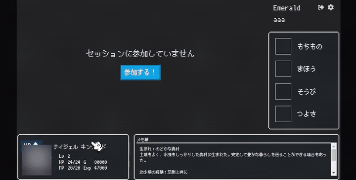
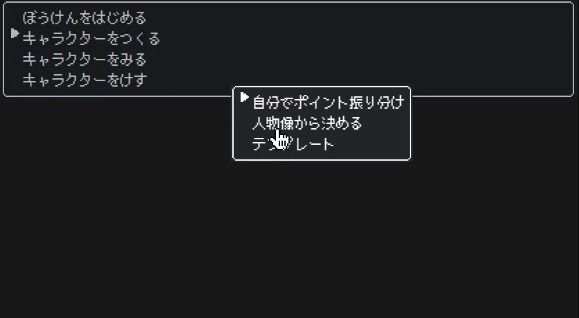
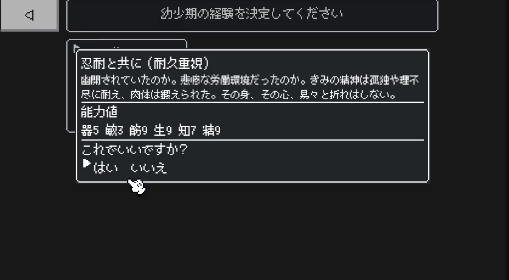
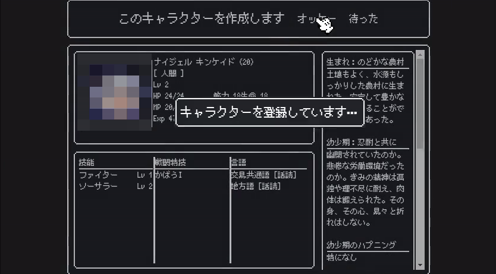
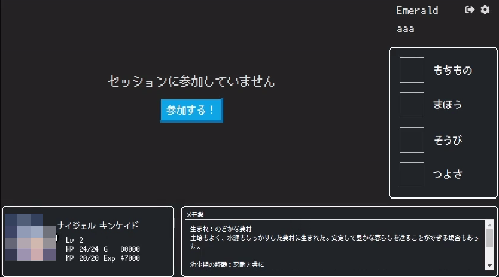
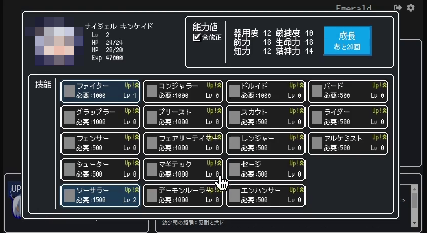
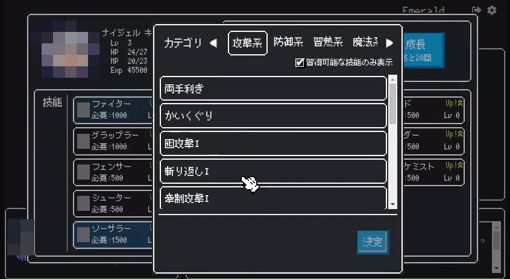

#+TITLE: Emerald — ソード・ワールド 2.5 セッション管理ツール（開発停止中）

仲間内で TRPG「ソード・ワールド 2.5」を遊ぶために作った、キャラクター作成とステータス管理の Web ツールです。
昔の家庭用ゲーム機のメニュー画面のような見た目にしました。
2020 年 11 月から 2021 年 8 月にかけて友人 2 名と余暇で開発し、キャラクター作成と成長・装備・所持品の管理まで作ったところで止まっています。

このリポジトリはフロントエンド（ClojureScript）です。サーバー（Clojure）は [[https://github.com/Nankk/emerald-server][emerald-server]] にあります。

* できること

- キャラクター作成: 生まれ・幼少期・青年期などを選んで能力値を決める「人物像から決める」方式
- 技能・戦闘特技の習得と、経験点による成長

* 未完成、今後の予定

- 装備・所持品・所持金の管理と買い物（実装途中）
- GM（ゲームマスター）ロールの作成
- GMとプレイヤー複数人が同じセッションに参加し、シナリオを進める

* 画面

- メニューと幼少期の選択
  
  
- キャラクター作成の確認とセッション画面
  
  
- 成長と戦闘特技の選択
  
  

動画: [[./docs/video/character-creation.mp4][キャラクター作成（52 秒）]]、[[./docs/video/session-growth.mp4][セッションと成長（42 秒）]]。
キャラクターの立ち絵は手元の画像を使っていたため、キャプチャと動画ではぼかしています。

* 構成

#+begin_example
ブラウザ ── emerald-frontend（ClojureScript / re-frame）     ← このリポジトリ
                │ REST（Swagger で仕様公開）
            emerald-server（Clojure / Ring / Reitit）
                ├── PostgreSQL（キャラクター・セッション）
                └── ルールデータ（Excel ブック。起動時に読み込み）
#+end_example

- フロントエンド（本リポジトリ）: ClojureScript、shadow-cljs、re-frame + Reagent、re-com、garden（CSS も Clojure で記述）、React 16、Bootstrap 4。フォントは PixelMplus。
- サーバー（[[https://github.com/Nankk/emerald-server][emerald-server]]）: Clojure 1.10、Ring + Jetty、Reitit（Swagger UI 付き）、PostgreSQL、duratom。
  Excel の読み込みには [[https://github.com/Nankk/docjure][docjure を自分でフォークした版]]（Clojars に ~org.clojars.nankk/docjure~ として公開）を使っています。
  POI が未実装の関数（TEXTJOIN など）を含むセルで数式の評価に失敗したとき、ファイルに保存されている計算結果を読むようにした改良で、テスト付きです。
- どちらも Docker イメージをビルドでき、GitLab CI でタグ付け時にコンテナレジストリへ登録していました（ ~.gitlab-ci.yml~ は当時のまま）。

* 分担

- 画面、キャラクター作成の流れ、サーバーの API とデータモデル: Nankk（本人）
- Dockerfile、docker-compose、GitLab CI: 友人 2 名

コミット履歴がそのまま分担の記録です。

* ルールデータについて

技能・特技・装備・人物像などのデータは、ルールブック（グループ SNE / KADOKAWA）の内容を Excel ブックに書き写したものです。
著作物のため、リポジトリには含めていません（履歴からも除いています）。
データの列構成と読み込み規則は [[https://github.com/Nankk/emerald-server/blob/master/resources/data/README.org][emerald-server/resources/data/README.org]] に書いてあります。
そのため、クローンしてもそのままでは起動できません。

* 開発

** 依存関係
- Node と npm
- OpenJDK 8 以上（shadow-cljs が JVM 上で動きます）

** ビルドと実行
#+begin_src sh
git clone https://github.com/Nankk/emerald-frontend.git
cd emerald-frontend
npm install                      # shadow-cljs も npm パッケージとして入る
npx shadow-cljs watch app        # 変更を検知して再ビルド。開発時はこれ
npx shadow-cljs release app      # リリースビルド
#+end_src

ブラウザで ~localhost:8700~ を開くと画面が出ます。サーバーが動いていないと表示されません。
開発時は ~localhost:3000~ のサーバーへ接続します。接続先は ~src/emerald_frontend/const.cljs~ の ~server-url~ で変えられます。

** Docker
#+begin_src sh
docker build -t emerald-frontend .
docker run -it -p 8080:80 --rm emerald-frontend     # localhost:8080
#+end_src

* 状態

2021 年 8 月で開発を止めています（メンバーの都合で遊ぶ機会が減ったため）。装備と買い物は実装途中、GM 機能は未着手です。
当時の設計判断と、今なら変える点のメモは [[./docs/retrospective.org][docs/retrospective.org]] にあります。
